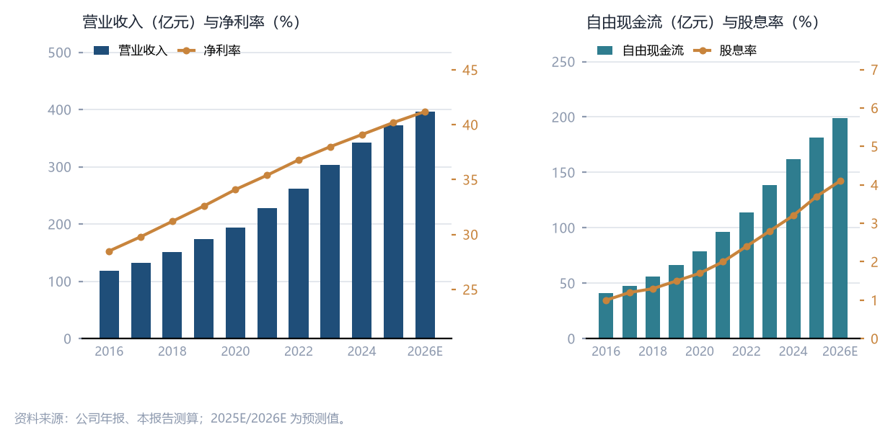

# 澜沧水电（601234.SH）首次覆盖：折旧到期与现金流的双重拐点

## 一、投资摘要

> **核心结论**
> 我们用「度电自由现金流」给澜沧水电定价：2026 年每度电贡献 0.146 元自由现金流，按 8.5% 折现率、3% 永续增速，对应权益价值 3,420 亿元，即每股 28.8 元。
> 折旧到期是未来四年最确定的变量——2026—2029 年累计 380 亿元折旧到期，账面净利率因此抬升 4.6 个百分点，而现金一分未变。
> 关键跟踪指标：①澜沧江来水（偏丰／偏枯）；②云南电力市场化交易电价；③澜沧江外送通道利用率。

**首次覆盖，给予「买入」评级，目标价 28.60 元**，对应 2026 年 20.9 倍 PE、4.1% 股息率。目标价较现价 22.40 元有 28% 的上行空间，其中 12 个百分点来自盈利增长，16 个百分点来自估值修复。

**投资逻辑可以拆成三条**：

- **顺风一：折旧到期。** 公司 2016—2018 年集中投产的四座电站，机组折旧年限按 20 年计提，2026 年起陆续到期；折旧是账面成本而非现金成本，到期只会把利润表做厚，不会削弱现金流。
- **顺风二：电价结构性上行。** 云南市场化交易电量占比已从 2019 年的 42% 提升至 2025 年的 78%，公司凭借多年调节库容在高价时段多发少弃，度电电价从 0.271 元升至 0.286 元。
- **顺风三：资本开支退坡。** 主体工程投产后，资本开支从 2022 年的 68.3 亿元降至 2025 年的 46.0 亿元，自由现金流因此连续三年抬升。

**表 1　关键假设：电价与电量（2025A—2027E）**

| 项目 | 2025A | 2026E | 2027E |
| --- | ---: | ---: | ---: |
| 上网电价（元/kWh，不含税） | 0.286 | 0.291 | 0.296 |
| 发电量（亿 kWh） | 1,302 | 1,362 | 1,414 |
| 度电成本（元/kWh） | 0.0988 | 0.0965 | 0.0947 |
| 装机容量（万千瓦） | 3,180 | 3,260 | 3,260 |

三个假设里我们最有把握的是**度电成本**：它主要由折旧、人工与水资源费构成，三者都近乎刚性，只在电量增长时被摊薄。相对不确定的是**上网电价**——若 2027 年云南市场化电价回落 3 分/kWh，我们测算 2027 年归母净利润将下降 11.4%，目标价下调至 25.10 元。

图 1 的右侧面板是这份报告的核心论据：自由现金流在 2023 年首次超过净利润，并在 2025 年达到净利润的 1.21 倍。这是折旧到期叠加资本开支退坡的必然结果，也是股息率能够从 2023 年的 2.8% 抬升至 2026 年 4.1% 的物质基础。

## 二、生意本质：把水头变成现金流

水电站的商业模式可以用一句话概括：**用一次性的资本开支，买下一段四十年的免费燃料**。燃料成本为零，可变成本只有水资源费与少量人工，因此一旦跨过盈亏平衡点，增量电量的边际利润率接近 90%。这也是水电资产在利率下行期被当作「类债券」的核心原因：它的现金流可见度远高于火电与风电。

### 2.1 一座水电站的三张表

理解澜沧水电，需要把三张表分开看：**电量表**决定收入的上限，**成本表**决定利润的弹性，**现金流表**决定股东能拿回多少。电量表由装机与来水共同决定，来水是唯一无法预测的变量；成本表里 62% 是折旧，只要资产不过剩，这部分成本不会随电量波动；现金流表则是两者的最终映射，也是我们估值的锚。

- **电量表**：3,180 万千瓦装机，多年调节库容 168 亿立方米，可把丰水期的水存到枯水期发。
  - 平水年发电量 1,302 亿 kWh，利用小时 4,094 小时，显著高于全国水电平均的 3,600 小时。
  - 偏枯年份电量下降 8%—12%，但电价通常同步上行，收入波动被部分对冲。
- **成本表**：营业成本 128.6 亿元，其中折旧摊销 101.5 亿元、占比 79%，水资源费与人工合计不足 9%。
  - 折旧到期不产生现金流入，但会把折旧科目替换为更高的税前利润。
- **现金流表**：经营现金流 227.5 亿元，资本开支 46.0 亿元，自由现金流 181.5 亿元，分红 97.5 亿元，剩余全部用于偿还有息负债。

### 2.2 电价：从计划电到市场化

云南是全国电力市场化改革的先行省份，电价的形成机制在过去七年发生了三次实质性变化。对澜沧水电而言，每一次变化都在**向好**的方向上：市场化比例越高，公司凭借调节能力获得的溢价越明显。

1. 优先发电计划：保障居民与农业用电，价格执行政府核定电价，约占公司电量的 22%。
2. 市场化双边交易：与大工业用户直接签约，价格由供需决定，2025 年均价 0.294 元/kWh。
3. 现货市场试点：2024 年起云南现货连续结算试运行，峰谷价差最高达 0.41 元/kWh。
4. 绿电与绿证溢价：水电绿证单价约 3—6 元/张，对应度电溢价不足 0.001 元，短期可忽略。

#### 2.2.1 电价上行的三个观察点

第一是**来水的季节性分布**：澜沧江 78% 的径流集中在 6—10 月，若汛期来水偏丰而外送通道受限，省内电价会在丰水期塌陷。第二是**外送通道容量**：澜沧江—广东特高压直流的设计输送能力为 800 万千瓦，利用率每提升 5 个百分点，公司综合电价上升约 0.6 分/kWh。第三是**煤价**：云南火电仍是边际定价者，秦皇岛煤价每上涨 50 元/吨，省内市场化电价平均上行 1.8 分/kWh。

---

需要强调的是，上述三点都不改变公司的成本结构，只改变收入的价格标签。这也是我们愿意在电价下行周期中给予「买入」评级的原因：**成本刚性、收入有弹性**，是罕见的正偏态生意。

## 三、财务表现：折旧到期与自由现金流拐点

2025 年公司营业收入 372.4 亿元，同比增长 8.9%；归母净利润 149.7 亿元，同比增长 12.0%。利润增速快于收入增速的原因只有一个：折旧摊销在 2025 年见顶（101.5 亿元）后开始回落，而收入端仍在增长。我们把这一现象称为「剪刀差」——它在 2026—2029 年会持续放大。

### 3.1 折旧：账面成本与现金成本的裂口

按照公司披露的会计政策，水工建筑物折旧年限 40—50 年，机组设备 20 年，2016—2018 年投产的四座电站（玉曲、班果、勐糯、南汀）合计装机 1,240 万千瓦，对应年折旧约 62 亿元。这批资产的机组折旧将在 2026—2029 年陆续到期，我们的模型假设平均到期时点为 2027 年中。

折旧到期对报表的影响可以精确到科目：**营业成本减少、利润总额增加、所得税增加、净利润增加**，而经营现金流完全不变。以 2029 年为例，62 亿元折旧全部到期后，按 12.5% 的实际税率测算，净利润将增厚 54.3 亿元，相当于 2025 年净利润的 36%。

- 2026 年到期折旧 9.8 亿元，净利润增厚 8.6 亿元；
- 2027 年到期折旧 21.4 亿元，净利润增厚 18.7 亿元；
- 2028—2029 年到期折旧 30.8 亿元，净利润增厚 27.0 亿元。

### 3.2 主要财务数据

下表把历史与预测放在同一口径下，便于读者核对「折旧到期」在报表中的落点。需要提示的是，2026 年起的财务费用下降同样贡献利润，其来源是自由现金流对高息负债的置换，而非会计估计变更。

**表 2　主要财务数据与估值指标（单位：亿元，除标注外）**

| 项目 | 2023A | 2024A | 2025A | 2026E | 2027E |
| --- | ---: | ---: | ---: | ---: | ---: |
| 营业收入 | 302.8 | 341.9 | 372.4 | 396.2 | 418.6 |
| 营业成本 | 118.4 | 124.7 | 128.6 | 131.4 | 133.9 |
| 毛利 | 184.4 | 217.2 | 243.8 | 264.8 | 284.7 |
| 毛利率（%） | 60.9 | 63.5 | 65.5 | 66.8 | 68.0 |
| 财务费用 | 32.6 | 29.1 | 25.4 | 21.8 | 18.3 |
| 折旧与摊销 | 96.8 | 99.2 | 101.5 | 98.7 | 94.2 |
| 投资收益 | 6.4 | 7.1 | 7.8 | 8.2 | 8.6 |
| 利润总额 | 138.6 | 160.7 | 179.4 | 195.0 | 211.8 |
| 所得税 | 18.2 | 19.9 | 21.4 | 23.2 | 25.1 |
| 少数股东损益 | 5.3 | 7.1 | 8.3 | 8.6 | 9.8 |
| 归母净利润 | 115.1 | 133.7 | 149.7 | 163.2 | 176.9 |
| 净利率（%） | 38.0 | 39.1 | 40.2 | 41.2 | 42.3 |
| ROE（%） | 13.6 | 14.9 | 15.8 | 16.4 | 17.1 |
| 经营现金流 | 191.3 | 211.5 | 227.5 | 241.2 | 254.2 |
| 资本开支 | 52.7 | 49.4 | 46.0 | 42.5 | 39.8 |
| 自由现金流 | 138.6 | 162.1 | 181.5 | 198.7 | 214.4 |
| 资产负债率（%） | 58.2 | 55.7 | 53.1 | 50.4 | 47.6 |
| 每股收益（元） | 0.97 | 1.12 | 1.26 | 1.37 | 1.49 |
| 每股股息（元） | 0.62 | 0.72 | 0.82 | 0.92 | 1.01 |
| 股息率（%） | 2.8 | 3.2 | 3.7 | 4.1 | 4.5 |
| PE（x） | 23.1 | 20.0 | 17.8 | 16.4 | 15.0 |
| PB（x） | 3.14 | 2.98 | 2.81 | 2.68 | 2.57 |

表中 2027 年自由现金流 214.4 亿元，已能覆盖当年 120.1 亿元的分红需求，剩余 94.3 亿元可用于继续降杠杆。按我们的模型，公司有息负债率将在 2028 年降至 40% 以下，届时财务费用对利润的侵蚀基本消失。

## 四、估值与情景

我们采用**度电自由现金流折现**与**股息率比较**两种方法交叉验证。前者给出每股 28.8 元的内在价值，后者以长江电力、华能水电等同业 4.0%—4.5% 的股息率中枢为锚，给出每股 26.5—29.9 元的区间，两者结论一致。据此设定目标价 28.60 元。

**表 3　三情景估值（2026E）**

| 情景 | 概率 | 目标价（元） | 2026E PE（x） |
| --- | ---: | ---: | ---: |
| 乐观：来水偏丰、电价上行 | 25% | 34.50 | 25.2 |
| 中性：平水年、电价持平 | 55% | 28.60 | 20.9 |
| 悲观：枯水叠加电价回落 | 20% | 21.50 | 15.7 |
| **加权** | **100%** | **28.66** | **20.9** |

悲观情景假设 2027 年市场化电价回落 3 分/kWh、来水偏枯 10%，此时 2027 年归母净利润降至 148.2 亿元，对应每股收益 1.25 元。即便如此，公司仍能维持 3.1% 的股息率与 1.05 倍的股息覆盖，估值下限并不脆弱。

### 4.1 风险提示
- **来水风险**：澜沧江径流年际波动可达 ±15%，枯水年发电量下降直接影响收入，且无法通过电价完全对冲。
- **电价风险**：云南市场化电价与煤价、外送通道利用率高度相关，若现货市场规则调整，公司溢价能力可能被削弱。
- **政策风险**：水资源费征收标准、西部大开发税收优惠（实际税率 12.5%）均存在调整可能。
- **利率风险**：公司有息负债 1,412 亿元，若融资成本上行 50bp，年财务费用增加 7.1 亿元。

<!-- pagebreak -->

## 五、附录：口径说明

- 数据来源：公司 2023—2025 年年度报告、2026 年半年度报告、云南电力交易中心月度成交披露。
- 电价口径：均为不含税上网电价，含市场化交易与优先发电计划加权平均。
- 预测假设：来水按平水年（P50）处理，装机按已投产与在建项目投产计划处理，不考虑新的资产注入。
- 估值口径：自由现金流＝经营现金流－资本开支，未扣除财务费用，与公司分红能力直接对应。

### 5.1 目标价敏感性：电价 × 电量

我们把两个最难预测的变量交叉起来看：上网电价的每 3% 变动约影响 2027 年归母净利润 7.2 亿元，电量的每 5% 变动约影响 9.4 亿元。下表给出对应的目标价（元）。

**表 4　目标价敏感性：电价变动 × 电量变动（2027E）**

| 电价变动＼电量变动 | -5% | 0% | +5% |
| --- | ---: | ---: | ---: |
| -6% | 24.16 | 26.06 | 27.96 |
| -3% | 25.43 | 27.33 | 29.23 |
| 0% | 26.70 | **28.60** | 30.50 |
| +3% | 27.97 | 29.87 | 31.77 |
| +6% | 29.24 | 31.14 | 33.04 |

即便在最不利的象限（电价 -6%、电量 -5%），目标价仍有 24.16 元，较现价 22.40 元高 7.9%——这正是我们把「买入」评级建立在折旧到期而非电价上行上的原因。

### 5.2 数据来源

- 公司年报：[2023 年年度报告](http://www.cninfo.com.cn/)、[2024 年年度报告](http://www.cninfo.com.cn/)、2025 年年度报告。
- 半年度数据：2026 年半年度报告（未经审计）。
- 电价数据：云南电力交易中心月度成交披露、昆明电力交易中心年报。
- 同业对照：长江电力 600900.SH、华能水电 600025.SH 的公开披露口径。
- 宏观假设：8.5% 折现率、3% 永续增速，与我司公用事业组统一口径一致。

本报告所有预测基于公开信息与我们的模型假设，不构成对任何证券的买卖建议。水电企业的年度业绩受来水影响较大，请投资者结合自身风险承受能力独立判断。
